# ChampSim 多预取器集成与并行实验平台

> 第二次汇报 · 图文汇报版

## 1. 项目做了什么

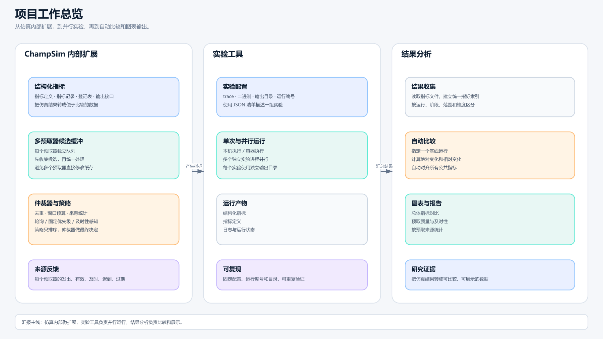

本项目基于 ChampSim 做两部分工作。第一部分进入模拟器内部，加入结构化指标和多预取器仲裁；第二部分在模拟器外部建立并行实验、自动比较和图表生成工具。

这样做的目的不是单纯增加功能，而是让预取器实验能够被稳定运行、结构化比较，并形成可用于分析的结果。

## 2. 总体类图

### 仿真内部扩展

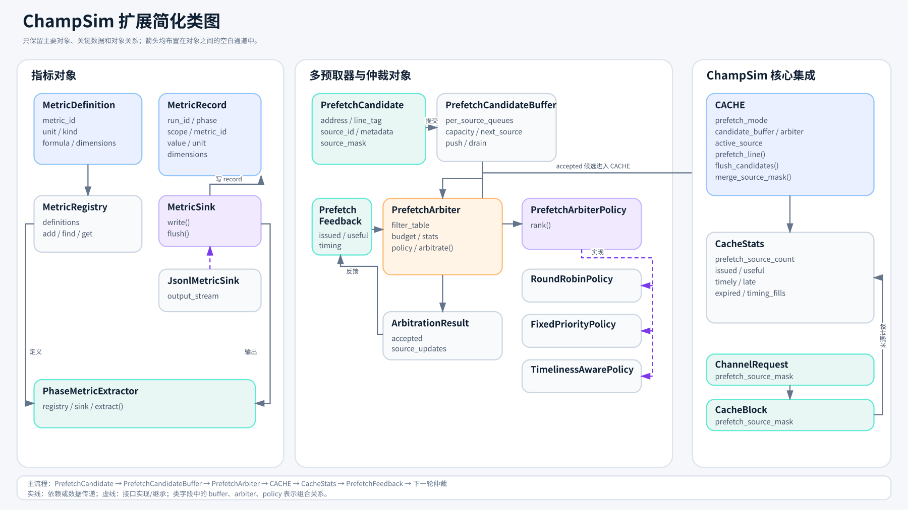

指标对象负责描述、记录和输出仿真结果；多预取器对象负责候选收集、去重、预算和仲裁。仲裁后的请求进入缓存，预取来源继续传播到缓存块和统计对象。

### 实验工具

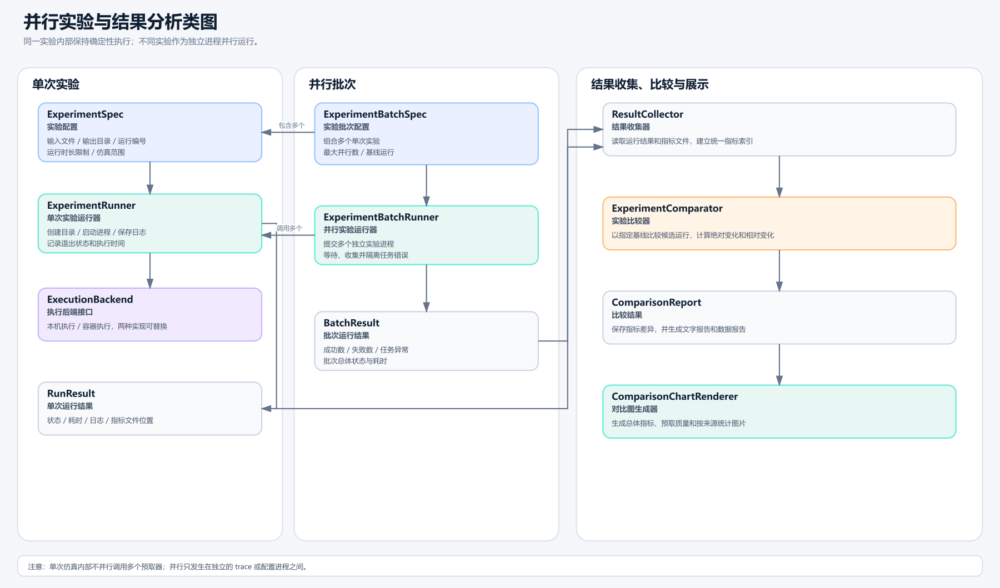

单次实验由 `ExperimentSpec` 和 `ExperimentRunner` 管理；多个实验由 `ExperimentBatchRunner` 并行调度；结果交给收集器、比较器和图表生成器处理。

## 3. 指标子系统

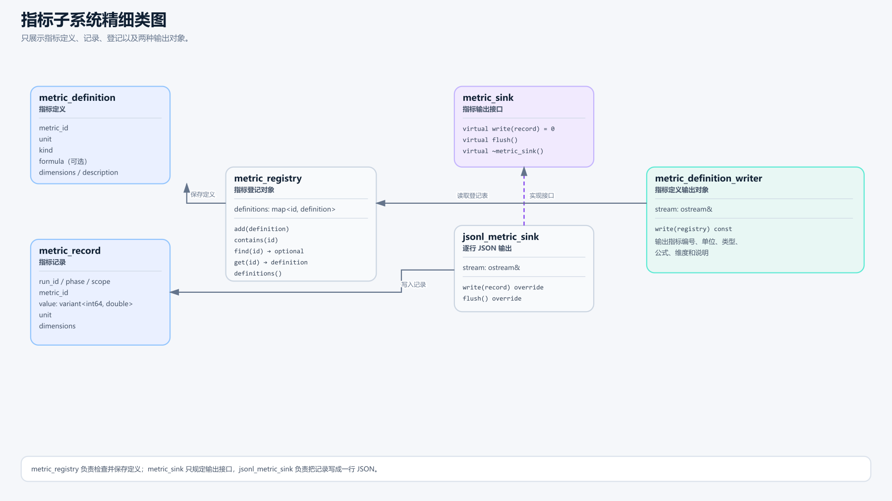

指标部分被拆成四类对象。`metric_definition` 说明指标是什么；`metric_record` 保存一次运行的具体值；`metric_registry` 统一管理指标定义；`metric_sink` 规定输出接口，由 `jsonl_metric_sink` 把记录写成逐行 JSON。

其中 `metric_registry` 是管理和检查指标定义的核心类：

```cpp
class metric_registry
{
public:
  void add(metric_definition definition);

  [[nodiscard]] bool contains(std::string_view metric_id) const;
  [[nodiscard]] std::optional<metric_definition> find(std::string_view metric_id) const;
  [[nodiscard]] const metric_definition& get(std::string_view metric_id) const;
  [[nodiscard]] std::size_t size() const;
  [[nodiscard]] const std::map<std::string, metric_definition, std::less<>>& definitions() const;

private:
  std::map<std::string, metric_definition, std::less<>> definitions_{};
};
```

`public` 部分给出外部可以调用的操作。`add()` 添加指标定义，`contains()` 判断指标是否存在，`find()` 返回可能存在的定义，`get()` 要求定义必须存在。`private` 中的 `definitions_` 以 `metric_id` 为键保存定义，外部不能直接修改内部表，因此重复检查和公式规则不会被绕过。

指标输出和指标定义也分开保存。`jsonl_metric_sink` 只负责输出每次运行的指标值，`metric_definition_writer` 负责输出指标编号、单位、公式和维度说明。

## 4. 多预取器与仲裁

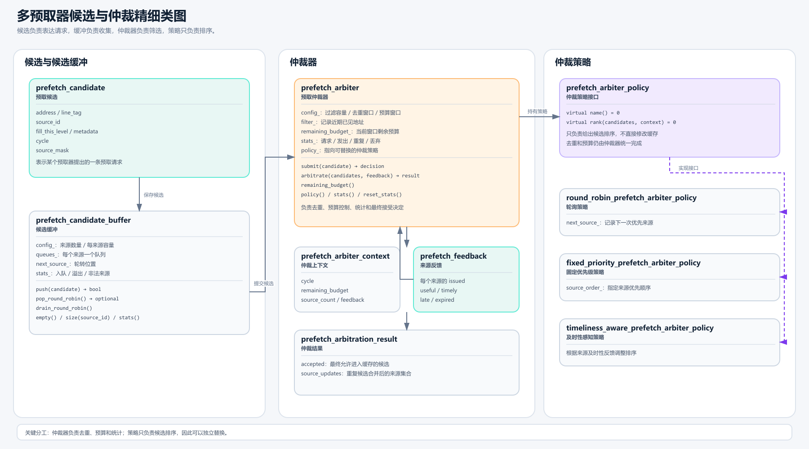

多个预取器不能直接修改缓存，否则候选顺序、重复地址和预算控制会混在一起。因此系统先让每个预取器产生 `prefetch_candidate`，再由 `prefetch_candidate_buffer` 按来源收集，最后交给 `prefetch_arbiter` 统一判断。

`prefetch_candidate` 保存地址、行标记、来源编号、产生周期和来源集合。候选缓冲为每个来源维护独立队列，负责容量限制、轮转取出和溢出统计。

仲裁器的类定义如下：

```cpp
class prefetch_arbiter
{
public:
  explicit prefetch_arbiter(
      prefetch_arbiter_config config = {},
      std::unique_ptr<prefetch_arbiter_policy> policy = nullptr);

  [[nodiscard]] prefetch_decision submit(const prefetch_candidate& candidate);
  [[nodiscard]] prefetch_arbitration_result arbitrate(
      const std::vector<prefetch_candidate>& candidates,
      const prefetch_feedback& feedback = {});
  [[nodiscard]] const prefetch_arbiter_stats& stats() const;
  [[nodiscard]] std::size_t remaining_budget() const;
  [[nodiscard]] const prefetch_arbiter_policy& policy() const;

private:
  prefetch_arbiter_config config_;
  std::vector<filter_entry> filter_;
  std::size_t remaining_budget_{};
  uint64_t window_start_cycle_{};
  bool window_started_{};
  prefetch_arbiter_stats stats_;
  std::unique_ptr<prefetch_arbiter_policy> policy_;
};
```

`public` 部分负责提交候选、批量仲裁和查询状态。`private` 部分保存配置、过滤表、剩余预算、窗口状态、统计和策略对象。去重和预算由仲裁器统一执行，因此任何策略都不能绕过这些规则。

`prefetch_arbiter_policy` 只负责排序。轮询、固定优先级和及时性感知是三个具体实现。及时性策略根据每个来源的历史反馈计算分数：

```cpp
auto score = [&](std::size_t source_id) {
  const auto& feedback = context.feedback.sources.at(source_id);
  const auto timely = static_cast<double>(feedback.timely);
  const auto late = static_cast<double>(feedback.late);
  const auto expired = static_cast<double>(feedback.expired);
  return (timely + 1.0) / (timely + late + expired + 1.0);
};

std::stable_sort(order.begin(), order.end(), [&](std::size_t lhs, std::size_t rhs) {
  return score(candidates.at(lhs).source_id) > score(candidates.at(rhs).source_id);
});
```

分数越高，说明该来源过去的预取越及时。加 1 是为了避免反馈数量少时出现除零，`stable_sort` 则保证同分候选保持原有顺序。

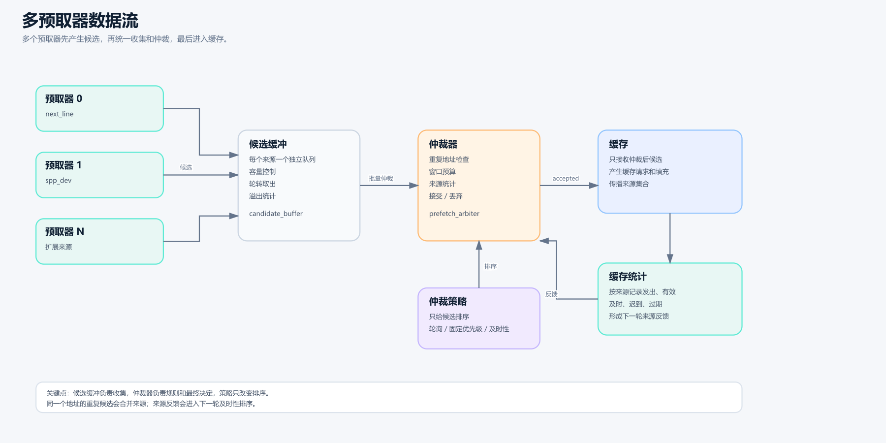

## 5. 预取来源传播与反馈

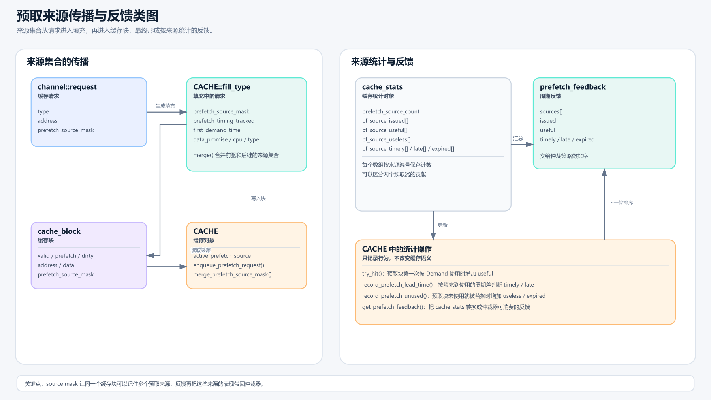

预取被仲裁后，系统还要记录它来自哪个预取器，以及后来是否真正被使用。来源信息用 `prefetch_source_mask` 表示，同一个缓存块可以由多个来源共同贡献：

```cpp
retval.prefetch_source_mask =
    predecessor.prefetch_source_mask | successor.prefetch_source_mask;
```

`cache_stats` 为每个来源保存 issued、useful、useless、timely、late 和 expired 等数组。预取块被 Demand 使用时增加 useful；根据填充到使用的周期差判断及时或迟到；未使用就被替换时增加 useless 和 expired。

`CACHE::get_prefetch_feedback()` 最后把这些统计整理成 `prefetch_feedback`，交回及时性感知策略。这样来源信息就形成了从候选、缓存块、统计到下一轮仲裁的闭环。

## 6. 并行实验平台


实验层把“运行什么”和“怎样运行”分开。`ExperimentSpec` 保存单次实验的二进制、trace、输出目录、运行编号和仿真范围；`ExperimentRunner` 负责创建目录、启动进程、保存日志和生成运行结果。

```python
@dataclass(frozen=True)
class ExperimentSpec:
    run_id: str
    binary: Path
    trace: Path
    output_dir: Path
    timeout_seconds: Optional[float] = 3600.0
    warmup_instructions: Optional[int] = None
    simulation_instructions: Optional[int] = None
    extra_args: Tuple[str, ...] = ()
    config_path: Optional[Path] = None
```

`frozen=True` 使配置在创建后不能被随意修改。`ExperimentSpec` 还集中定义 `metrics_jsonl_path`、`stderr_path` 和 `result_path` 等输出位置，避免运行器到处拼接路径。

`ExecutionBackend` 是执行后端接口。本机执行和容器执行分别实现这个接口，因此运行器不需要关心 ChampSim 是直接运行还是在 Docker 中运行。

多个实验由 `ExperimentBatchSpec` 描述，批次运行器通过 `ThreadPoolExecutor` 同时等待多个独立进程：

```python
with ThreadPoolExecutor(max_workers=resolved.max_workers) as executor:
    futures = {
        run.run_id: executor.submit(runner.run, run)
        for run in resolved.runs
    }
```

线程只等待外部进程，不共享 Cache、候选缓冲或仲裁器状态。每个实验有独立 `run_id` 和输出目录；某个任务失败时，错误会记录为 `BatchTaskError`，不会覆盖其他实验结果。

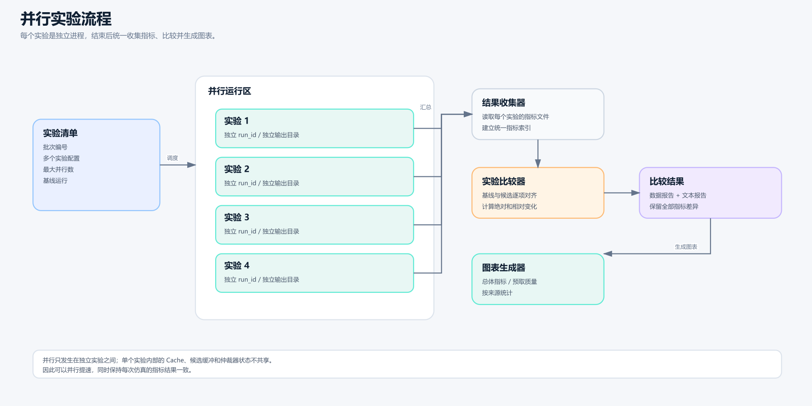

重复实验结果一致，说明多个独立进程之间没有状态污染。

## 7. 结果收集与对比

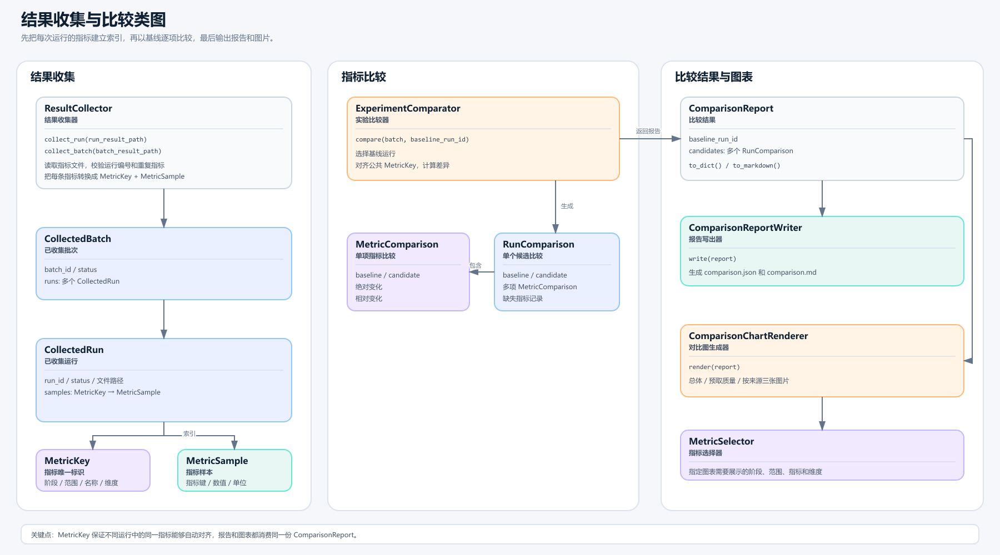

不同实验的指标必须先按同一身份对齐，才能比较。`MetricKey` 使用阶段、统计范围、指标名称和维度共同标识一个指标：

```python
@dataclass(frozen=True, order=True)
class MetricKey:
    phase: str
    scope: str
    metric_id: str
    dimensions: Tuple[Tuple[str, str], ...] = ()
```

`ResultCollector` 读取指标文件并建立索引，`ExperimentComparator` 以指定基线运行进行逐项比较。比较结果保存绝对变化和相对变化：

```python
absolute_delta = candidate.value - baseline.value
percent_change = (candidate.value - baseline.value) / baseline.value * 100
```

同一个 `ComparisonReport` 同时用于生成 `comparison.md`、`comparison.json` 和三张 PNG 图片。文字与图片共享同一套数据，因此不会出现表格和图不一致的问题。

## 8. 功能扩展效果与实验数据

原始版实际文本日志如下：

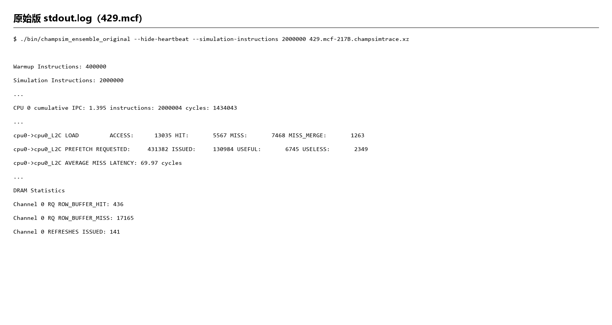

修改版实际结构化指标和自动比较表如下：

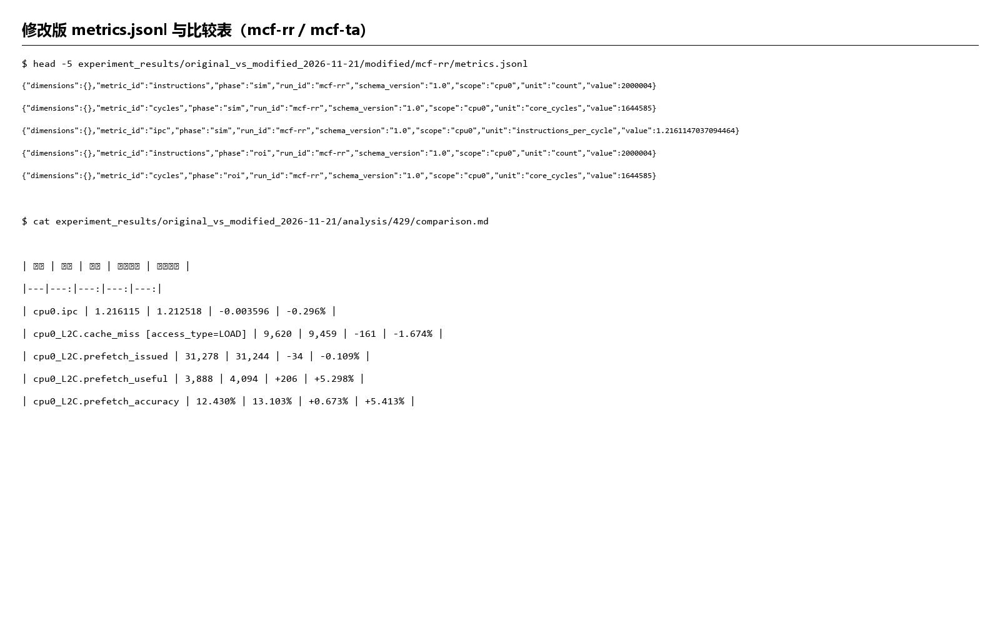

这一部分重点不是单一准确率，而是修改版是否真正提供了原版不具备的能力。原始版来自 Git 提交 `29e2ead`，两个版本都使用 `next_line + spp_dev` 两个预取器。

| 功能 | 原始版 | 修改版 |
|---|---|---|
| 结果输出 | 约 6.9 KB 文本日志 | 594 条结构化指标 + 指标定义 |
| 来源可观测性 | 只有总量 | 按预取器来源统计 |
| 多预取器处理 | 无统一 Arbiter | 候选缓冲 + 去重/预算/仲裁 |
| 策略比较 | 行为固定 | 轮询 / 固定优先级 / 及时性感知 |
| 多实验运行 | 人工逐次启动 | 4 个实验并行运行 |
| 自动比较 | 人工阅读日志 | 自动对齐指标并生成报告 |
| 可视化 | 无 | 总体、质量、来源三类图片 |

### 429.mcf

| 指标 | 原始版 | 修改版：轮询 | 修改版：及时性感知 |
|---|---:|---:|---:|
| IPC | 1.395000 | 1.216115 | 1.212518 |
| L2C LOAD miss | 7,468 | 9,620 | 9,459 |
| 预取请求数 | 431,382 | 73,088 | 73,592 |
| 实际发出预取 | 130,984 | 31,278 | 31,244 |
| 有效预取 | 6,745 | 3,888 | 4,094 |

### 600.perlbench_s

| 指标 | 原始版 | 修改版：轮询 | 修改版：及时性感知 |
|---|---:|---:|---:|
| IPC | 1.791000 | 1.790929 | 1.791049 |
| L2C LOAD miss | 605 | 629 | 612 |
| 预取请求数 | 9,432 | 1,572 | 1,572 |
| 实际发出预取 | 8,659 | 1,236 | 1,238 |
| 有效预取 | 281 | 230 | 269 |

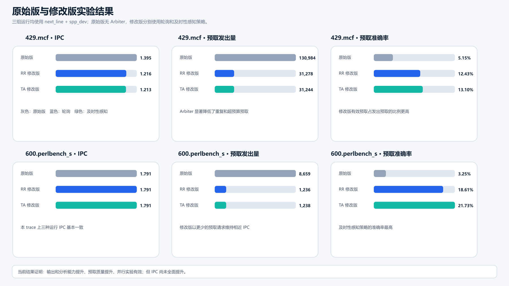

并行方面，修改版一次启动 4 个独立实验：

| 项目 | 数值 |
|---|---:|
| 4 个子任务耗时之和 | 46.409 秒 |
| 并行批次耗时 | 13.529 秒 |
| 实测加速比 | 约 3.43 倍 |

这些数据说明修改版在结构化输出、来源观测、统一仲裁、并行实验和自动报告方面已经形成完整链路。Arbiter 也实际改变了预取发出过程，例如 429.mcf 的发出量从 130,984 降到约 31,000。当前 429.mcf 的 IPC 低于原始版，600.perlbench_s 基本持平，因此还不能宣称 IPC 全面提升，后续仍需调参和增加 trace。

下面是修改版自动生成的 429.mcf 对比图：


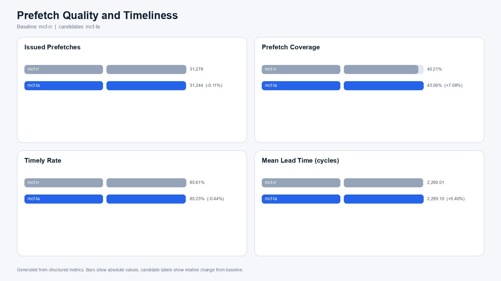

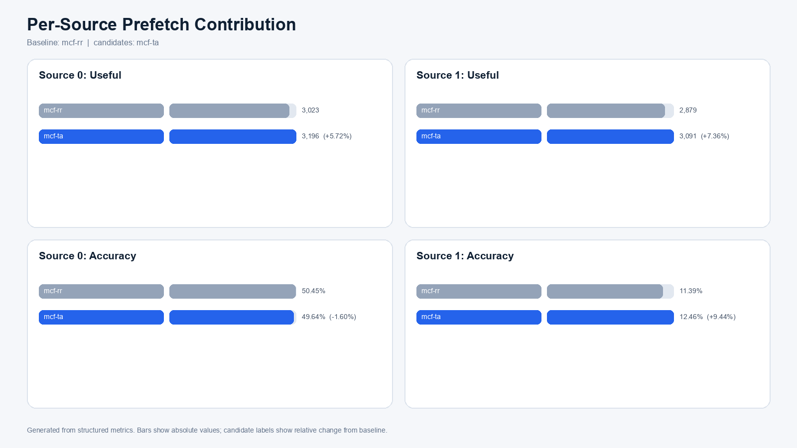

下面是修改版自动生成的 600.perlbench_s 对比图：

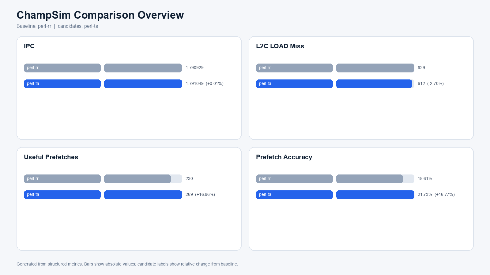

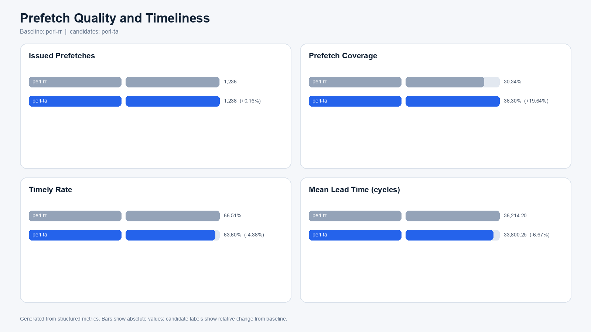

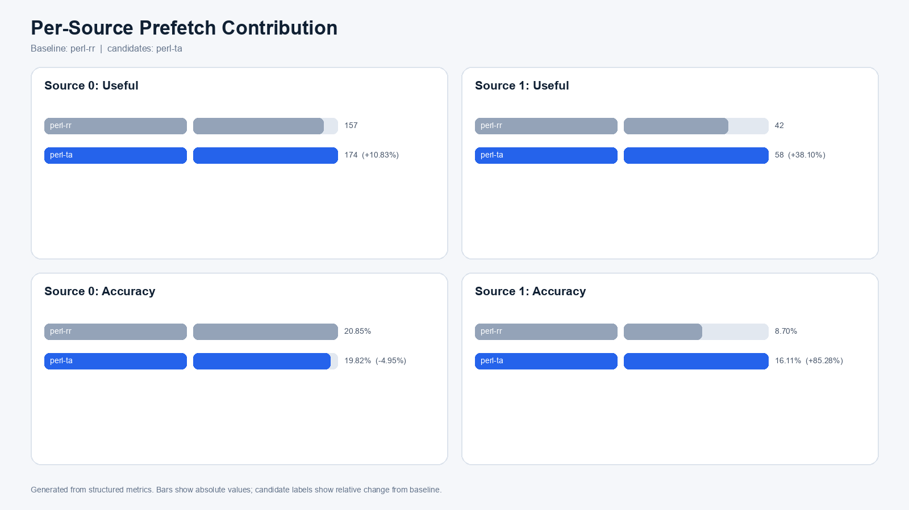

## 9. 结论与下一步

当前已经完成多预取器仲裁、结构化指标、并行实验和自动图表。实验说明预取质量可以提升，但“有用预取增加”不一定立即转化为 IPC 提升。

下一步需要调整预算和及时性权重，增加不同 trace，并分析预取是否真正减少了关键路径上的等待时间。

## 10. 现有不足与后续计划

当前实现已经打通多预取器仲裁、结构化输出、并行实验和自动报告，但仍有几个需要继续解决的问题。

**现有不足**

- trace 数量仍然偏少，目前只有 `429.mcf` 和 `600.perlbench_s` 两条。
- 单次仿真内部仍按顺序调用预取器，并行只发生在独立实验进程之间。
- 批量配置的规则要求用户手动修改输出目录，工具易用性仍需改进。
- 大规模 trace、长时间运行和异常注入测试还不充分。

**后续计划**

1. 扫描预算、去重窗口、时间窗口和来源权重，寻找更稳定的仲裁参数。
2. 增加连续访存、规则步长、不规则访问和高带宽压力等不同类型的 trace。
3. 增加关键路径收益、MSHR 占用、预取队列压力和 DRAM 带宽等指标。
4. 引入来源最小份额、动态预算和收益权重，避免单一预取器长期占优。
5. 评估仲裁逻辑的 RTL 可实现性，包括面积、时序和共享结构成本。
6. 改进批量工具，自动管理输出目录并支持 CSV、数据库和统一报告导出。

**验收目标**

正式实验至少应包含多条 trace、多组仲裁参数和完整比较报告。即使最终 IPC 仍不能稳定提升，也需要明确记录负结果、适用范围和后续改进方向。
